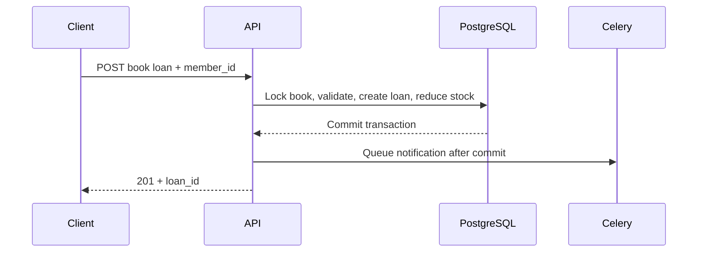

# Book loans, returns, and due dates

A Django REST API for a small lending library. Authors and books form the catalog, members are linked to Django users, and loans record who borrowed a book and when it should return. Celery handles notification delivery separately from API requests.

## The borrowing contract

A new loan starts with a 14-day due date. Borrowing decrements available copies; returning replenishes them once. Each member may have one active loan for a given book. Renewals accept a positive integer number of days and reject returned or already-overdue loans.



Loan and return operations share a book-row lock in PostgreSQL. Read-only loan endpoints prevent direct CRUD from bypassing stock changes. SQLite tests exercise behavior, not PostgreSQL's concurrent locking guarantees. A durable notification outbox is not implemented: the queue must be available when post-commit notifications are published.

## Start the development stack

The Compose file runs PostgreSQL, Redis, Django, and a Celery worker. Copy the example configuration and fill in `POSTGRES_PASSWORD` and a persistent, independently generated `DJANGO_SECRET_KEY`. Keep the resulting `.env` local.

```sh
cp .env.example .env
# Set the two values in .env before starting the stack.
docker compose up --build
```

Create an account in another terminal:

```sh
docker compose exec web python manage.py createsuperuser
```

Open `http://localhost:8000/api/` for the browsable API and use `/api-auth/login/` to sign in. All API endpoints require authentication. Development service ports bind to localhost; configure transport security and role-specific access rules before any shared deployment.

## Explore the API

| Operation | Endpoint | Body |
| --- | --- | --- |
| Catalog | `GET /api/authors/`, `GET /api/books/` | — |
| Members | `GET /api/members/` | — |
| Borrow | `POST /api/books/{id}/loan/` | `{"member_id": 1}` |
| Return | `POST /api/books/{id}/return_book/` | `{"member_id": 1}` |
| Inspect loans | `GET /api/loans/` | — |
| Extend due date | `POST /api/loans/{id}/extended_due_date/` | `{"additional_days": 3}` |

Create catalog and member records before borrowing; example IDs are illustrative. Lists use page-number pagination, with a default page size of 10 and a maximum requested size of 100. The [serializers](library/serializers.py) define writable catalog and member fields.

Mail goes to Django's console backend in development. `library.tasks.check_overdue_loans` selects active loans whose due date is before today. A periodic schedule for that task is not configured in this repository; run or schedule it explicitly when needed.

## Regression checks

```sh
docker compose exec web python manage.py test library --settings=library_system.test_settings
```

The test settings use an in-memory SQLite database and local email storage. Tests cover stock changes, duplicate borrowing, repeated returns, renewal validation, authentication, and overdue reminders. Existing commit-message utility tests are separate from the lending behavior.

Core code is in [library/](library/) and configuration in [library_system/](library_system/). The model default supplies due dates without a custom save override. Notification dispatch waits until the lending transaction commits, and nested list serializers use related-object loading to avoid a query for every displayed relation.
